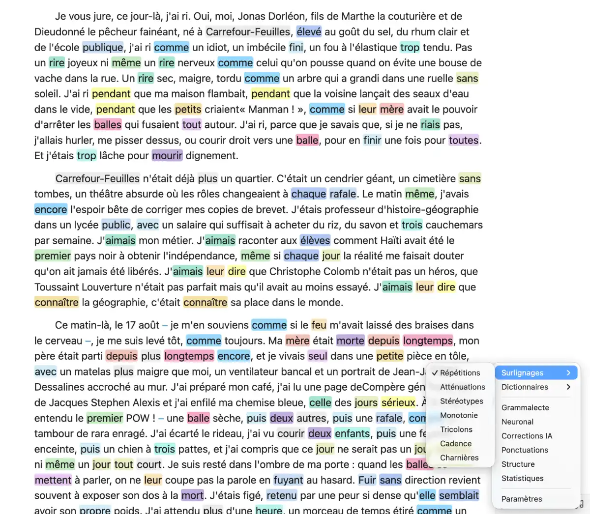

# Finition

**Un regard neuf sur vos textes, sans quitter Obsidian.**

Les mots qu’on répète sans les entendre, les phrases qui prennent toujours le même rythme… Finition les met en couleur dans vos notes. Vous gardez la main sur votre prose, avec des outils de correction et des dictionnaires français à portée de clic.

[Installer Finition depuis Obsidian](https://community.obsidian.md/plugins/finition) · [Signaler un problème](https://github.com/tcrouzet/finition/issues)

## Installer Finition

1. Dans Obsidian, ouvrir **Réglages → Plugins communautaires → Parcourir**.
2. Chercher **Finition**, puis choisir **Installer** et **Activer**.
3. Cliquer sur **♫**, dans la barre d’état, pour ouvrir les outils.

Obsidian **1.14 ou ultérieur** est requis. Le plugin est gratuit ; les fonctions IA sont facultatives.

Pour commencer avec les répétitions, ouvrir **Réglages → Finition → Corrections**, puis **Charger** en face de **Dictionnaire Finition**. Les autres dictionnaires et moteurs se téléchargent depuis leurs sections des réglages. Une fonction grisée indique qu’une ressource manque encore.

## Relire en couleurs

Ouvrir **♫ → Surlignages** et choisir ce que l’on veut observer :

- **Répétitions** retrouve les mots qui reviennent à proximité, y compris sous leurs formes conjuguées ou accordées. Chaque groupe reçoit sa couleur.
- **Atténuations** fait ressortir les précautions de langage : « il semblerait que », « dans une certaine mesure »…
- **Stéréotypes** repère les clichés et lieux communs, comme « serrer les poings ».
- **Monotonies** révèle les suites de phrases de longueur proche.
- **Tricolons** repère les séries de trois groupes de même construction. Les listes plus longues sont exclues.
- **Cadences** rapproche des phrases voisines de construction comparable.
- **Charnières** montre les articulations du texte : « mais », « et », « que », « comme »…
- **Formes** surligne les phrases négatives, interrogatives, exclamatives et celles contenant des points de suspension (`...` ou `…`). Les 4 couleurs se choisissent dans **Réglages → Finition → Palette**. Une phrase cumulant plusieurs formes compte une seule fois ; le survol les indique toutes et la ponctuation détermine sa couleur principale (interrogation, exclamation, puis suspension).
- **Copules** surligne les flexions des verbes de la liste dédiée (« être », « avoir », « sembler », « devenir »…), avec leurs formes pronominales (« se montrer », « se révéler », « s’appeler »). Les auxiliaires des temps composés sont exclus : « avons connu » n’est pas surligné, « ai un bateau » l’est. Ce mode utilise le dictionnaire Finition ; sa couleur par défaut est 14, réglable dans **Palette**. Les emplois adjectivaux des participes restent ambigus.

L’analyse conserve la position du curseur. Le compteur et les flèches permettent de parcourir les passages repérés. Cliquer sur un passage surligné fait ressortir son groupe en noir : le compteur et les flèches se limitent alors à ce groupe. Recliquer sur le groupe ou cliquer hors surlignage rétablit la navigation complète. Quand une analyse est active, **Reset**, en bas du menu musique, efface ses surlignages et suggestions sans modifier le texte.

Une seule analyse stylistique est active à la fois ; recliquer sur son nom la désactive. Les couleurs, les distances de recherche et les sensibilités se règlent dans **Réglages → Finition**. Sur les longues notes, l’analyse porte sur le début jusqu’à la limite configurée : le texte reste entier.

Le bloc YAML en tête de note et les tags `#mot` ou `#thème/sous-thème` sont exclus des analyses et des textes envoyés à l’IA. La ponctuation les préserve. Un bloc YAML commencé mais non fermé reste exclu jusqu’à la fin de la note.

### Structure et statistiques

Pour regarder le texte de plus près, activer **Mode debug** dans les réglages :

- **Structure** crée une note d’analyse phrase par phrase : cadratifs, sujets, verbes, compléments et groupes de trois.
- Les verbes négatifs y sont représentés par **NE PAS VERBE**, y compris avec « plus », « jamais » ou « rien ».
- **Statistiques** exporte les mesures disponibles dans une note séparée : décomptes, lemmes, répétitions et tricolons.

L’original reste intact. Structure et Tricolons demandent un moteur linguistique installé ; Statistiques demande aussi Grammalecte et le lexique commun. Ces analyses restent indicatives : elles peuvent manquer des passages ou en signaler à tort.

## Corriger le français

Choisir **Grammalecte** ou **Neuronal** dans le menu **♫** :

- **Grammalecte** vérifie l’orthographe et la grammaire, avec le dictionnaire classique ou les rectifications de 1990.
- **Neuronal** associe le dictionnaire morphologique à un modèle local pour rechercher aussi des confusions de mots en contexte. Ce moteur reste expérimental.

Les deux analysent la sélection, ou toute la note si rien n’est sélectionné. Cliquer sur une faute pour choisir une correction ou ignorer le signalement. Les mots inconnus peuvent être ajoutés au dictionnaire personnel. La flèche de la barre d’état mène à la faute suivante. Recliquer sur le correcteur coché efface ses suggestions.

Une barre rouge dans la marge repère les lignes portant des corrections orthographiques ou IA en attente. Elle disparaît lorsque les corrections de la ligne sont traitées.

Le modèle public **CamemBERT** se charge dans les réglages. Des modèles personnels peuvent aussi être importés ; le choix du moteur d’analyse de Structure, Tricolons et Cadences reste indépendant du correcteur utilisé.

### Soigner la ponctuation

**Ponctuations** harmonise les espaces insécables, les apostrophes, les tirets et les lignes vides, y compris les espaces entre un nombre et son unité. Elle remplace `...` par `…`. Le code, les liens et les horaires sont préservés.

Cette commande modifie directement toute la note, sans étape de validation.

## Dictionnaires

Sélectionner un mot, ouvrir **♫ → Dictionnaires** et choisir le dictionnaire :

- **Synonymes** propose des variantes, regroupées par sens et catégorie lorsque le dictionnaire le permet.
- **Flexions** affiche toutes les flexions disponibles dans le lexique actif, à partir d’un mot ou de son lemme.
- **Définitions** aide à vérifier le sens d’un mot.
- **Antonymes** propose ses contraires.
- **Phonétique** donne sa prononciation.
- **Rimes** cherche des mots à rapprocher par leur sonorité.

Cliquer sur un synonyme remplace la sélection. Le bouton **Insérer la liste en remarque** conserve les résultats après le paragraphe dans un commentaire Obsidian `%% … %%`. La fenêtre se déplace par son titre pour laisser voir le texte.

Chaque dictionnaire public se télécharge avec **Charger** dans sa section des réglages, puis se met à jour avec **Recharger**. **Flexions** utilise le lexique déjà installé. Tous les dictionnaires acceptent aussi vos fichiers au [format Finition](doc/dictionnaires.md).

**Synonymes**, **Étymologie** et **Citations** recherchent les lemmes du mot sélectionné avec le lexique actif : « bateaux » retrouve « bateau ». Les citations sont aussi indexées sur les lemmes de leur texte ; leur formulation et leurs références restent intactes. Sans lexique installé, la recherche reste limitée aux formes exactes. **Phonétique** et **Rimes** conservent la forme sélectionnée.

**Citations** rassemble plus de 34 000 extraits de plus de 470 auteurs, issus du Wiktionnaire et de Wikiquote, avec leurs références : Balzac, Sand, Hugo, Rousseau, Proust, Colette, Gide… La sélection suit le domaine public français en 2026, avec contrôle des dates de décès, traductions et exceptions connues. Après une mise à jour du corpus, sélectionner **Recharger** sur la ligne **Finition** de cette section dans les réglages. Les [sources et critères de sélection](doc/dictionnaires.md#conjugaisons-étymologie-citations-et-champ-lexical) sont documentés.

## Une IA, si vous la souhaitez

Les fonctions locales n’exigent aucune clé API. Pour utiliser une IA, renseigner une clé **Anthropic** ou **OpenAI** et choisir le modèle dans **Réglages → Finition → Corrections IA**. Ces appels peuvent être payants auprès du fournisseur choisi.

Les modèles proposés sont définis dans [`plugin/ai/models.json`](plugin/ai/models.json) : `value` contient l’identifiant du modèle, `label` son nom affiché. Le premier est le défaut des nouvelles installations. Après modification du JSON, reconstruire le plugin avec `npm run build` ; les choix déjà enregistrés sont conservés.

Sur ordinateur, si **Codex CLI** est détecté, **Codex** apparaît dans **Modèle par défaut** et **Modèle pour ce prompt**. Codex doit déjà être connecté. Le champ **Codex : modèle** propose les modèles renvoyés par Codex pour les corrections et les synonymes ; **Modèle configuré par défaut** conserve le choix de la machine. **Recharger** actualise cette liste sans lancer de génération ni envoyer le texte d’une note. Le choix est mémorisé dans Finition et ne change pas la configuration de Codex. Aucune clé API supplémentaire n’est nécessaire. Codex est prioritaire sur le serveur local lorsqu’il est choisi. Une connexion absente ou une erreur est signalée, sans basculer vers un autre fournisseur. L’installation et la connexion à Codex restent à effectuer séparément.

Avec Ollama ou un autre serveur compatible OpenAI, renseigner **Serveur local** (par exemple `http://localhost:11434`, avec ou sans `/v1`) et **Modèle local**, sous les clés API. Le serveur doit déjà fonctionner et disposer du modèle indiqué. Sauf si Codex est choisi, ces champs remplacent le fournisseur et le modèle cloud pour les deux fonctions ci-dessous, sans transmettre les clés API. Vider **Serveur local** pour revenir à Claude/GPT. Finition ne télécharge aucun modèle et ne bascule jamais vers le cloud en cas d’erreur locale.

- **Corrections IA** relit la sélection, ou toute la note si rien n’est sélectionné, et marque les mots ou signes modifiés. Cliquer sur le rouge, le vert ou la coche accepte la correction. La poubelle refuse la suggestion et conserve le texte original. La coche précède toujours la poubelle.
- **Synonymes IA**, dans le menu Dictionnaires, cherche des variantes adaptées au contexte de la sélection.

Les consignes de relecture sont personnalisables et peuvent être enregistrées avec leur modèle. Les liens restent intacts dans la note.

## Confidentialité

Après téléchargement des dictionnaires et modèles, les surlignages, les correcteurs locaux et les dictionnaires fonctionnent hors ligne. Les ressources viennent de GitHub ; aucune note n’y est envoyée.

Les fonctions IA s’exécutent uniquement sur demande. **Corrections IA** envoie la sélection, ou toute la note sans sélection, au fournisseur choisi ou au serveur configuré ; **Synonymes IA** envoie aussi les paragraphes voisins pour tenir compte du contexte. Avec un serveur et un modèle exécutés sur votre machine, le texte reste local. Si vous indiquez un serveur distant ou un modèle cloud via Ollama, le texte peut quitter votre machine. Les clés API sont conservées dans les réglages du plugin.

Avec Codex, le texte fourni est transmis au service configuré dans Codex : ce choix n’est pas une IA hors ligne. Finition lance une conversation éphémère hors du coffre, avec les outils et intégrations désactivés et un environnement en lecture seule. Le plugin ne modifie ni la connexion ni la configuration enregistrée de Codex ; les propositions restent soumises à votre validation dans Finition.

Finition n’accède pas au presse-papiers. Les notes et les copies de dictionnaires sont gérées par l’API Obsidian. Les accès extérieurs concernent les imports choisis, le chargement d’un modèle depuis un chemin renseigné dans les réglages et la détection de l’exécutable Codex. Codex gère lui-même l’accès à sa configuration et à sa connexion.

## Documentation

Pour les formats d’import, les sources et les limites des données :

- [Lexique commun et dictionnaires personnels](doc/lexique.md)
- [Dictionnaires de synonymes](doc/synonymes.md)
- [Définitions, antonymes, phonétique et rimes](doc/dictionnaires.md)
- [Modèles neuronaux locaux](doc/neural-model.md)
- [Ressources publiques et leurs licences](resources/README.md)
- [Licence du code](LICENSE)

Un problème ou une idée ? [Ouvrir un ticket sur GitHub](https://github.com/tcrouzet/finition/issues), en précisant la version d’Obsidian, le système et, si possible, un court exemple.

## Versions bêta

L’installation courante se fait depuis le catalogue Obsidian. **[BRAT](https://github.com/TfTHacker/obsidian42-brat)** sert à tester les versions bêta :

1. Installer et activer BRAT depuis les plugins communautaires d’Obsidian.
2. Ajouter le dépôt `tcrouzet/finition` dans BRAT et choisir la version bêta à tester.
3. Activer Finition dans les plugins communautaires.

Voir le [guide de BRAT](https://tfthacker.com/brat-quick-guide) pour le choix d’une version et les mises à jour.
